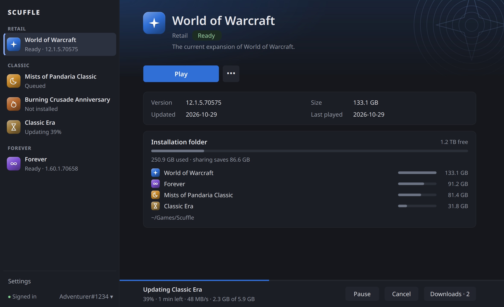

# Scuffle

Scuffle installs, updates and launches the public World of Warcraft clients
without the Battle.net app. One folder holds every installed client, and the
content they share is stored once.



- Every public client: Retail, Mists of Pandaria Classic, Burning Crusade
  Anniversary, Classic Era with Hardcore and Season of Discovery, Forever, and
  the PTRs and betas.
- A download queue with pause and resume that survives restarts, a speed limit,
  and cleanup of content no client needs.
- Battle.net's own sign-in page, a sign-in that lasts as it does in a browser,
  and several Battle.net accounts to switch between.
- Shortcuts that start a client straight from your app launcher or from Steam.
- Import from an existing installation, such as Battle.net's, without
  downloading what it already has.
- Linux through Proton and `umu-run`, and Windows natively.

Scuffle is not affiliated with or endorsed by Blizzard Entertainment. Downloads
come from Blizzard's public CDN. Scuffle is a third-party launcher, and you use
it at your own risk. See [DESIGN.md](DESIGN.md) for how it works.

## Install

Scuffle is experimental. Back up your WTF and Interface folders before you
point it at clients you care about, and expect rough edges. Download the
current version from
[Releases](https://github.com/nyrda/scuffle/releases). Each release lists the
SHA-256 sums of its files in `SHA256SUMS`, and GitHub records how each file was
built, which `gh attestation verify Scuffle.exe -R nyrda/scuffle` checks.

**Windows**: `Scuffle.exe` is a single file with everything inside. Put it in a
folder of its own and start it. It is not signed yet, so Smart App Control,
which Windows 11 turns on for many new installations, can block it, sometimes
only on its first start.

**Linux**: the AppImage runs on Ubuntu 22.04 and newer, Fedora, Arch and
SteamOS. Python, Qt, `umu-launcher` and the bridge are inside. Proton still
comes from Steam, ProtonUp or another launcher.

```sh
chmod +x Scuffle-0.1.0-x86_64.AppImage
./Scuffle-0.1.0-x86_64.AppImage
```

It needs FUSE, which desktops install as `fuse3`. Without it,
`--appimage-extract-and-run` unpacks it to a temporary folder first, which goes
when Scuffle exits, so close the game before Scuffle.

**Nix**: the flake builds Scuffle from source.

```sh
nix profile install github:nyrda/scuffle   # or nix run github:nyrda/scuffle
```

## Updating Scuffle

Scuffle asks GitHub once a day whether a newer version is out and says so in the
window, the tray and a notification. **Update and restart** downloads it, checks
it against the release's checksum and checks that it starts on your system, then
replaces the program. Nothing is installed unless you click, and Scuffle waits
while a game runs or a download is active. The AppImage keeps its file name, so
shortcuts go on working. A folder Scuffle cannot write to stops the update, and
**Release notes** has the download instead.

**Settings › General** has **Check for Scuffle updates** and **Skip this version**.
`scuffle self-update` does the same from the command line. Nix installations are
only told about a release, since Nix owns the package.

## First start

Choose an installation folder in the settings. Scuffle owns that folder, so do
not let Battle.net manage it at the same time. Then install a client, or import
one you already have.

On Linux, Scuffle finds Proton builds in the usual places, such as
`~/.steam/root/compatibilitytools.d`, and uses the newest unless you pick one in
the settings. All clients share one Wine prefix in
`~/.local/share/scuffle/prefix`.

## Signing in

The first **Play** shows Battle.net's own sign-in page inside Scuffle, with its
address above it. Sign in there as you would in a browser. Scuffle does not read
the page or what you type. It reads the address the page ends at and the cookies
Battle.net sets.

Battle.net ends a game session that sits unused for some hours. Scuffle then
signs in again by itself, the way a browser that is still signed in to
Battle.net does, so you see the sign-in page again only when Battle.net itself
asks for it. The session and the cookies are protected with DPAPI and kept under
`~/.local/share/scuffle/session` with owner-only permissions. Scuffle never
reads the Battle.net app's saved login, so both stay signed in.

**Your own browser.** **Use my browser instead** on the sign-in page opens the
page in your browser, for a password manager or a security key. After you sign
in, the browser fails to open a page at `http://localhost:0/?ST=...`. Copy that
address from the address bar. Scuffle reads it from the clipboard when you
switch back, or you can paste it. Scuffle remembers the choice, and **Sign in
here** changes it back. A sign-in in your browser lasts only as long as the
game session, so Scuffle asks again about once a day. The AppImage and
`Scuffle.exe` do not have the sign-in window yet and always use your browser.

**Several accounts.** The sidebar shows the signed-in account by its BattleTag,
or "Account 1" until Battle.net sends one. Its menu switches accounts, signs out
of one, and has **Add account…**, which shows an empty sign-in page for the
other account. With your own browser, a browser that is signed in to Battle.net
answers at once for that account, so **Add account…** does not open it by
itself. Use **Copy link** and open it in a private window, or **Open in
browser** when your browser is not signed in. **Play** always uses the account
the sidebar shows, and you cannot switch while a game is starting.

**WoW accounts.** When a Battle.net account has several WoW accounts, the
sidebar offers a **WoW account** choice, and the game starts with the one you
pick. **Ask in the game** brings back the game's own question.

## Clients

The list shows the live clients. **Settings › Clients** adds test clients, the
PTRs and betas, one by one. **Show other public clients** offers older builds
Blizzard still publishes, such as the Dark Realm Test. Many of those are old
and may not connect. Any client can be hidden with **Hide from list** in its
**⋯** menu. When Blizzard adds a client, Battle.net's own catalog puts it in the
list without a Scuffle update.

Each row shows the version Blizzard publishes for your region and whether the
client is installed, downloading or behind its live game. Scuffle checks for
updates on start, every 30 minutes and before each launch, and keeps the last
answer for when it is offline. If a client is behind, **Play** starts its
update instead.

While a game runs, its button reads **Close game**, which closes it as its
window's close button does. Hold Shift for **Force quit**, for a game that
hangs.

**Uninstall…** in the **⋯** menu removes a client. Content other clients share
stays. By default your WTF, Interface and Screenshots folders move to
`Scuffle-backup-<client>-<id>` inside the installation folder. Close the game
and finish its downloads first. If Scuffle closes halfway, it finishes the
removal on the next start.

## Downloads

Downloads run one at a time. The Downloads page reorders waiting jobs, pauses
or resumes the queue and estimates the total time. The queue survives closing
Scuffle: unfinished jobs come back paused, in order, and continue from what is
already stored.

**Settings › Downloads** sets a speed limit in MB/s, 0 for none, and 1 to 64
connections. Downloads can also pause while a game runs and resume when it
exits. Resuming downloads when Scuffle starts is off by default. After each
install or update, Scuffle removes content no installed client needs.

## Automatic updates

**Install updates automatically** in **Settings › Downloads** lets every
installed live client update by itself once Blizzard publishes a new version.
It is off until you turn it on. A live client's **⋯** menu has **Don't update
automatically** to leave that one out. Test and other clients stay manual
unless you choose **Update automatically** in their own **⋯** menu.

While it is off, the notification for a new version offers **Update now** and
**Always update automatically**. Where a notification has no buttons, as on
Windows, clicking it opens the client, whose page offers the same two choices.

An automatic update uses the download queue like any other, with the same speed
limit and order. It never writes to the installation folder while a game from
that folder runs, any client's game, because a running game rearranges the
content all clients share. It waits, shown as **Waiting for games**, and starts
by itself when the last game closes. **Resume** runs it at once all the same,
and pausing or resuming it by hand makes it an ordinary update that waits for
you.

A failed automatic update is notified once. Scuffle tries that version again by
itself only after three hours, or sooner when a newer version comes out.
**Try again** always works at once. When it finishes you get a notification
that names the new version.

The tray menu says when the next check runs, and **Check now** checks at once.

**Start Scuffle when I sign in, in the tray** in **Settings › General** starts
Scuffle hidden in the tray when you sign in to your desktop, so it can keep the
clients up to date. Without a tray its window opens instead. On Linux this is
`~/.config/autostart/scuffle.desktop`, on Windows a value under
`HKCU\Software\Microsoft\Windows\CurrentVersion\Run`. Turning it off removes
only an entry Scuffle made. `scuffle --tray` starts the same way by hand.

## Importing an installation

For a client installed elsewhere, for example by Battle.net, choose **Import…**
in its **⋯** menu instead of **Install**. Scuffle looks in Wine, Lutris, Bottles
and Steam prefixes, `~/Games` and mounted drives, or on Windows in Program Files
and the folders Battle.net records. **Choose folder…** picks one it did not
find.

Each checked client becomes an ordinary download. Content that matches the
current build is copied, and only the rest is downloaded. **Copy settings and
addons** then copies `WTF` and `Interface` into the new client folder, keeping
files already there. Scuffle only reads the installation you import from, so
Battle.net can keep using it.

## Shortcuts

An installed client's **⋯** menu has **Add to app launcher**, or **Add to Start
menu** on Windows, and **Add to Steam**. Classic Era's entry offers its modes as
actions. Steam rewrites its game list while it runs, so quit Steam first.
Scuffle asks you to and keeps a copy of the old list as
`shortcuts.vdf.scuffle-backup`. Steam installed through Flatpak cannot start
programs outside its sandbox and is not offered.

A shortcut works like **Play**. With a valid session and an up-to-date client
the game starts without a Scuffle window. Otherwise the window opens on that
client. Only one Scuffle runs at a time, and a shortcut hands over to a window
that is already open. Uninstalling a client removes its app launcher entry, and
Scuffle only ever removes files it made.

## Launch options

**Launch options…** in a client's **⋯** menu sets the arguments Wow.exe
understands, such as the graphics API, windowed mode or the console, and takes
extra ones such as `-config Config2.wtf`. On Linux a client can also have its
own environment variables.

On Linux the **Launch** card in the settings applies to every client:

- GameMode through `gamemoderun`, and MangoHud.
- Environment variables as `NAME=value` lines. A client's own variables win.
- A wrapper command before `umu-run`, as in Steam, such as
  `gamescope -w 2560 -h 1440 -f --`.
- The Proton log, written to `~/.local/share/scuffle/logs/steam-battlenet.log`.

An option the chosen Proton build or this machine cannot use, such as Wayland
or HDR, is greyed out, and its choice is kept for one that can.

## Tray and notifications

Scuffle notifies you when a download finishes or fails, when a client has a new
version or has updated by itself, when a start fails and when a game crashes.
Clicking a notification opens that client. Nothing is shown for the client you
are looking at. **Show notifications** in **Settings › General** turns them off.

Where the desktop has a tray, its menu shows the current download with **Pause
all** and **Resume all**, when the next update check runs with **Check now**, up
to five clients to start, and **Quit Scuffle**.
With **Keep running in the tray when the window is closed**, downloads carry on
after you close the window. Without a tray that setting is greyed out and
closing the window quits.

## Moving the installation

**Move…** next to the folder in **Settings › General** moves every client, the
shared content and Scuffle's records to an empty or new folder. **Choose…**
only points Scuffle at another folder.

On the same drive the folder moves at once. To another drive Scuffle copies
everything, checks the copy, switches to it and only then deletes the old
folder, so the copy needs the installation's size plus 1 GB free. Until the
copy is checked, **Cancel** leaves the old folder as it was. Close every game
and finish or remove every download first. If Scuffle or the computer stops
halfway, the next start finishes or undoes the move.

## Bug reports

**Copy diagnostics** in **Settings › Diagnostics** puts a short report on the
clipboard: Scuffle's version, the system, Proton and `umu-run`, the settings
that matter, the clients and downloads, and the last lines of the Proton log.
It leaves out your sign-in, account names and ids, your user name and your
home folder. Read it before you share it all the same. `scuffle diagnostics`
prints the same report.

**Logs.** **Open logs folder** in **Settings › Diagnostics** shows what Scuffle
keeps. `scuffle.log` says what Scuffle did: each start with its options, how each
game ended with the game's own exit code, downloads and updates. The `games`
folder holds the output of each client's last ten runs, with Wine's errors, which
is where a crash shows its reason. A crash notification names the exit code, such
as `0xc0000005, access violation`. Neither log holds a ticket, a token or an email. Report a bug as an
[issue](https://github.com/nyrda/scuffle/issues) and paste the report there.

## Command line

```sh
scuffle --root /games/Scuffle clients
scuffle --root /games/Scuffle install wow --region eu --locale enUS
scuffle --root /games/Scuffle install wow --seed-from "/games/World of Warcraft"
scuffle --root /games/Scuffle update wow
scuffle --root /games/Scuffle verify wow
scuffle --root /games/Scuffle play wow_classic_era --mode hardcore
scuffle diagnostics
```

The commands refuse to run while the window is open, except `clients` and
`diagnostics`, which only read. `--seed-from` copies verified content from an
existing installation and only reads it. Progress goes to stderr as JSON lines.
`play --shortcut` is what shortcuts run, and `--wait` keeps it running until
the game exits, as Steam needs.

On Windows, `Scuffle.exe` is a windowed program, so a terminal does not wait
for it. Use `start /wait "" Scuffle.exe ...` in cmd or
`Start-Process -Wait -NoNewWindow Scuffle.exe -ArgumentList ...` in PowerShell.

## Development

Building, testing and packaging are in [DEVELOPMENT.md](DEVELOPMENT.md).

## License

Scuffle is under the [MIT License](LICENSE). `Scuffle.exe` and the AppImage
also contain Python, Qt for Python (PySide6) under the LGPL 3 and the other
programs listed in [DEVELOPMENT.md](DEVELOPMENT.md), each under its own license.
